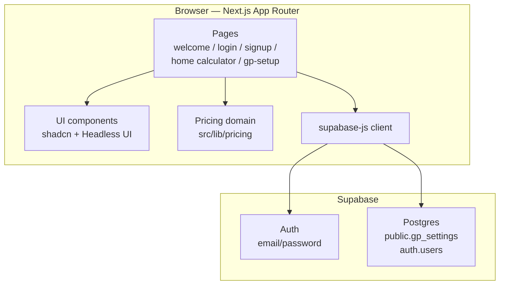
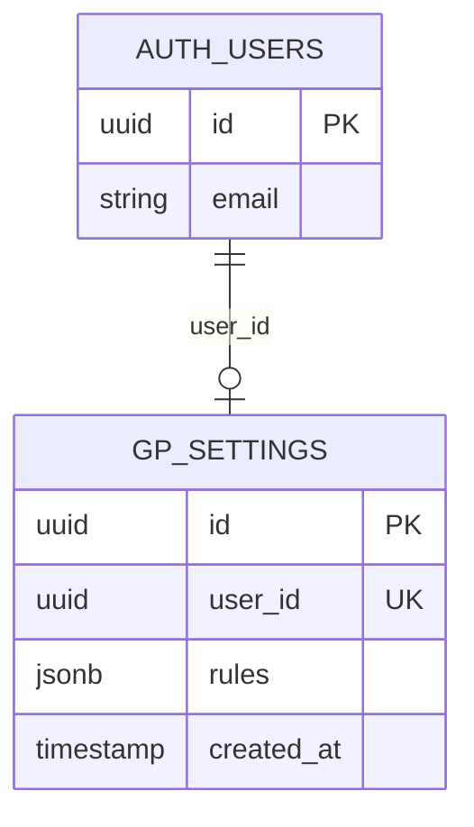
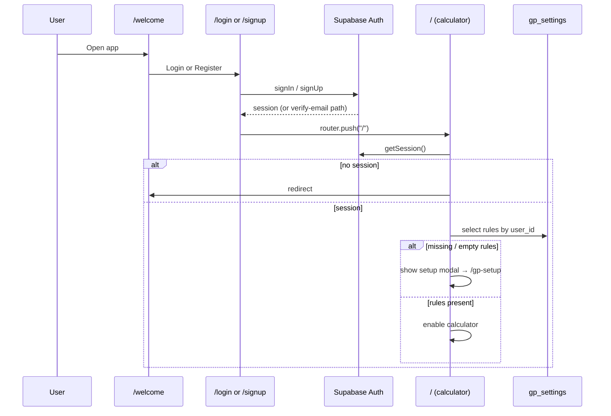
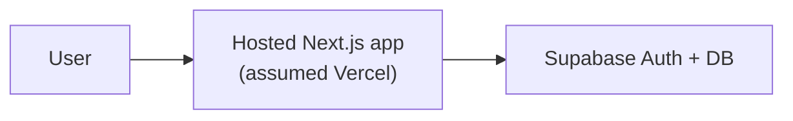
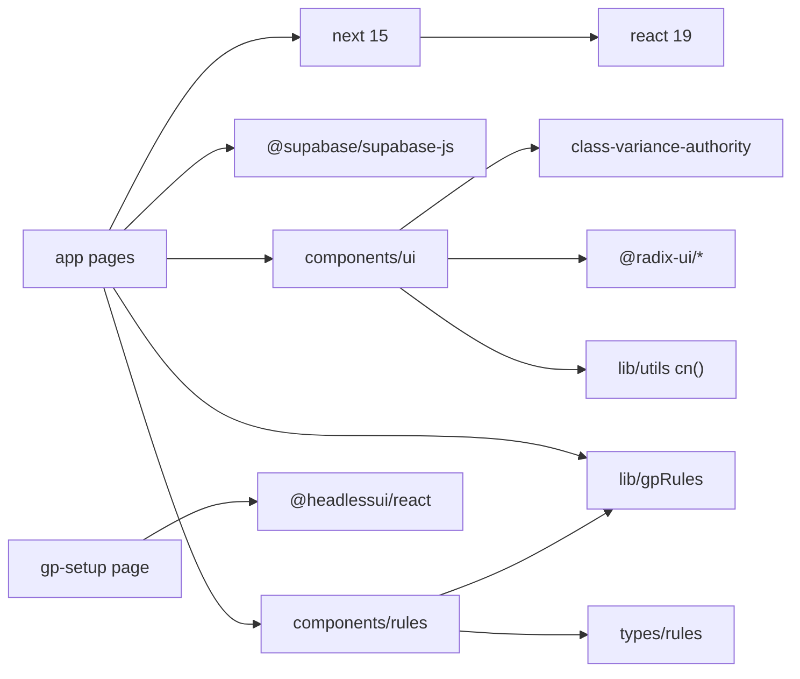
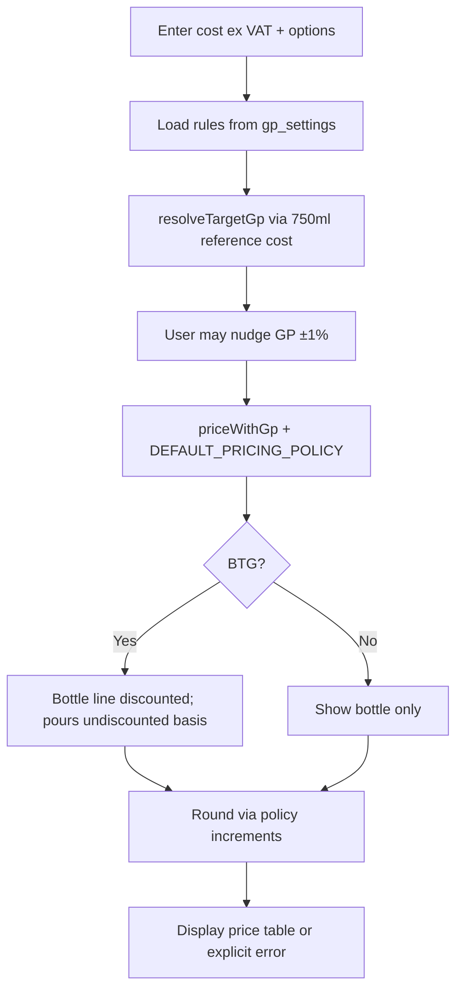
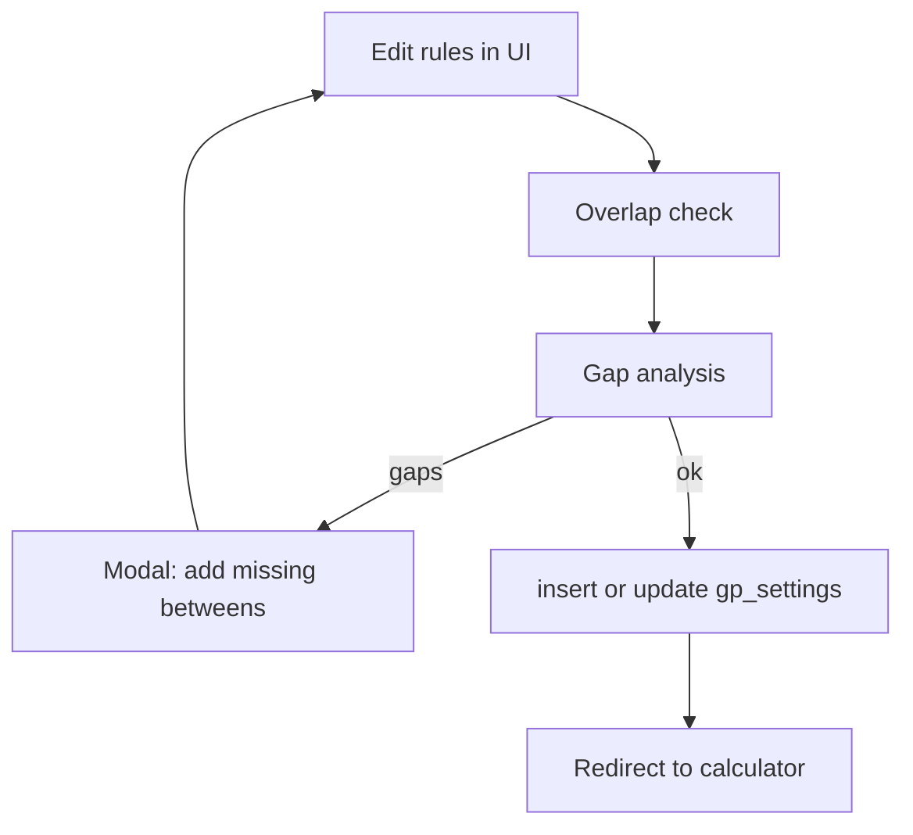

# Architecture — Wine GP Calculator

Detailed technical architecture reference. Companion to [`AI_CONTEXT.md`](./AI_CONTEXT.md).

**Documentation authority:** Repository/database evidence determines current implementation. Canonical intended architecture: [`05-project-architecture.md`](./05-project-architecture.md). Canonical current overview: [`06-current-implementation.md`](./06-current-implementation.md). This file provides supporting structural detail. If sources materially disagree, investigate rather than silently reconciling them.

This document describes the **current** client/Supabase structure. The shared pricing engine in `src/lib/pricing` is implemented (Stage 2). Sales import, scenarios, and user-configurable policy/serving-size UI remain future work — see `05`.

---

## Application Layers

The app is a thin **Next.js frontend** over **Supabase Auth + Postgres**. There is no custom application server or API route layer in this repository.

| Layer | Responsibility | Location |
|-------|----------------|----------|
| Presentation | Pages, forms, tables, modals, toasts | `src/app/**`, `src/components/**` |
| Pricing domain | Deterministic GP resolution, pricing, rounding, validation | `src/lib/pricing/**` |
| Form helpers | Input sanitize/validate for rule editor | `src/lib/gpRules.ts`, `src/types/rules.ts` |
| Integration | Supabase JS client | `src/lib/supabaseClient.ts` |
| Platform | Auth sessions, RLS, JSONB storage | Supabase project (hosted) |

---

## Frontend Architecture

- **Router:** Next.js App Router under `src/app`.
- **Rendering model:** Interactive routes are `'use client'` components. Root `layout.tsx` is a Server Component wrapping children with fonts + `ToastProvider`.
- **Styling:** Tailwind CSS v4 (`src/app/globals.css`, PostCSS plugin). shadcn “new-york” / slate theme via `components.json`.
- **Path alias:** `@/*` → `./src/*` (`tsconfig.json`).
- **Fonts:** Geist / Geist Mono via `next/font/google` in `layout.tsx`.

### Route structure

| Path | File | Auth expectation | Purpose |
|------|------|------------------|---------|
| `/welcome` | `src/app/welcome/page.tsx` | Public | Entry CTA |
| `/login` | `src/app/login/page.tsx` | Public | Sign in |
| `/signup` | `src/app/signup/page.tsx` | Public | Register |
| `/` | `src/app/page.tsx` | Session required (client check) | Calculator |
| `/gp-setup` | `src/app/gp-setup/page.tsx` | Session required | Rule editor |
| `/gp-setup/custom` | `src/app/gp-setup/custom/page.tsx` | Session required (check on save) | Alternate wizard (**unlinked**) |

There is **no** `middleware.ts` for route protection.

---

## Backend Architecture

**No first-party backend code** beyond what Next.js provides for serving the app.

Persistence and auth are entirely **Supabase**:

- Browser creates a singleton client in `src/lib/supabaseClient.ts`.
- Credentials are **hardcoded** (URL + anon key), not read from `process.env`.
- Data access uses the Supabase REST/Data API via `.from('gp_settings')` and Auth methods.

### API structure

| Kind | Present? |
|------|----------|
| Next.js Route Handlers (`src/app/api`) | **No** |
| Server Actions | **No** |
| Edge Functions (in repo) | **No** |
| Supabase client calls from pages | **Yes** (de facto API) |

Effective “API” surface used by the app:

| Operation | Client call |
|-----------|-------------|
| Sign up | `supabase.auth.signUp({ email, password })` |
| Sign in | `supabase.auth.signInWithPassword({ email, password })` |
| Sign out | `supabase.auth.signOut()` |
| Session | `supabase.auth.getSession()` |
| Load rules | `from('gp_settings').select(...).eq('user_id', id).single()` |
| Insert rules | `from('gp_settings').insert([{ user_id, rules }])` |
| Update rules | `from('gp_settings').update({ rules }).eq('user_id', id)` |
| Upsert rules | `from('gp_settings').upsert({ user_id, rules }, { onConflict: 'user_id' })` (custom page) |
| Email lookup on failed login | `from('users').select('id').eq('email', email).single()` — **broken relative to live schema** (no `public.users`) |

---

## Database Architecture

See [`DATA_MODEL.md`](./DATA_MODEL.md) for field-level detail.

**Summary:**

- One application table: `public.gp_settings`.
- Auth identities: `auth.users` (Supabase-managed).
- RLS enabled: users may only access rows where `auth.uid() = user_id`.
- `user_id` UNIQUE → at most one settings document per user.
- `rules` stored as **JSONB** (array of rule objects).

*(FK from `gp_settings.user_id` to `auth.users` is not present in live constraints inspected; relationship is logical via RLS + application code.)*

---

## State Management

- **No** Redux, Zustand, Jotai, React Query, or similar.
- Page-local React state (`useState`) + `useEffect` for:
  - session bootstrap / redirects
  - loading rules
  - debounced GP recalculation (~200ms timeout on home page)
- Cross-cutting UI state: React Context in `ToastProvider` (`showToast`).
- Auth session: managed internally by `supabase-js` (persisted in browser storage by the library).

---

## Authentication Flow

**Notes:**

- Signup may return without a session if email confirmation is enabled in the Supabase project; UI then asks the user to check email (`signup/page.tsx`).
- Password rules are enforced in the signup UI; server-side Auth policies are configured in Supabase (not in this repo).

---

## External Integrations

| Service | Usage |
|---------|--------|
| **Supabase** | Auth + Postgres Data API |
| **Vercel fonts / Next defaults** | Geist via `next/font`; stock `public/*.svg` from create-next-app |

No payment, email-sending SDK, analytics, or wine data APIs appear in dependencies or source.

---

## Error Handling

| Area | Pattern |
|------|---------|
| Login/signup | Toast messages via `useToast`; special-cases for rate limit / already registered |
| Calculator | Inline cost validation errors; missing rules → blocking modal |
| GP setup | Inline `error` string; Headless UI dialog for gaps; `confirm()` for deletes |
| Supabase errors | Often `.message` surfaced as text; some paths `console.error` |
| Shared toast | Auto-dismiss after 3s |

There is no global error boundary component in the repo.

---

## Configuration

| Config file | Role |
|-------------|------|
| `next.config.ts` | Default empty Next config object |
| `tsconfig.json` | Strict TS, path aliases |
| `eslint.config.mjs` | `next/core-web-vitals` + `next/typescript` |
| `postcss.config.mjs` | Tailwind v4 PostCSS plugin |
| `components.json` | shadcn generator settings |
| `package.json` | Scripts and dependencies |
| `.gitignore` | Ignores `.env*`, `.next`, `node_modules`, `.vercel` |

**Runtime secrets/config:** currently embedded in `supabaseClient.ts` rather than environment variables. `.gitignore` anticipates `.env*` files, but none are used by application code today.

---

## Deployment Architecture

**Identifiable from repo:**

- Standard Next.js app (`next build` / `next start`).
- README documents Deploy on Vercel (boilerplate).
- `.gitignore` includes `.vercel`.
- **No** `vercel.json`, Dockerfile, GitHub Actions, or other IaC in the repository.

**Assumption:** Production is (or is intended to be) a Vercel (or similar) Node host for Next.js, with Supabase remaining an external managed service. Confirm with the owner if another host is used.

---

## Dependency Relationships

**Notable absences:** E2E test framework, ORM, form libraries, state libraries, env validation (`zod` + `t3-env`, etc.). Domain unit tests use Vitest.

---

## Main User / Data Flow

Rule persistence flow (setup):

