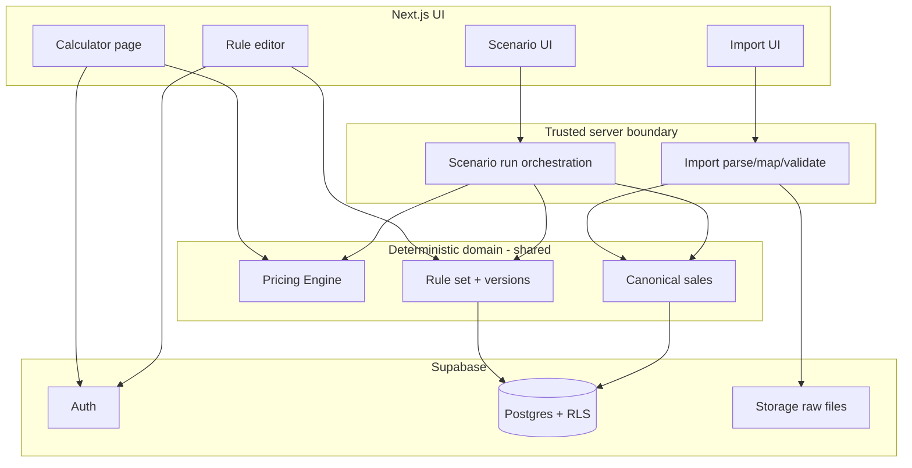

# Architecture Baseline & Sales Modelling Readiness Assessment

**Project:** Wine GP Calculator  
**Repository:** `DanWarham/wine-gp-calculator`  
**Evidence sources:** repository source, `package-lock.json`, live Supabase project `jcylgbtifwpcjncnnfok` (` wine-gp-calculator`), `npm audit`, GitHub advisory GHSA-9qr9-h5gf-34mp  
**Assessment date:** 2026-10-19  
**Mode:** Assessment only — no implementation performed

---

## 1. Executive Assessment

The existing application is a **sound incremental foundation**, not a rewrite candidate. It already has a coherent domain concept (user-owned GP rule sets), working auth/RLS for that narrow data surface, and a calculable pricing path that can be extracted into a deterministic engine.

**Incremental evolution is recommended.**

**Major blockers before trusting bulk sales/scenario work:**

1. **Critical:** installed `next@15.3.1` is affected by React Flight RCE (GHSA-9qr9-h5gf-34mp); patch starts at `15.3.6` (broader current remediation via later 15.5.x also available).
2. **Financial:** pricing logic lives only in the home-page React component, with no automated regression tests, and several edge cases (GP=100 → `Infinity`; whole-% rounding of interpolated GP; degenerate `between` bands).
3. **Infrastructure:** no in-repo (or remote) migrations; hardcoded Supabase client config; no server-side trust boundary for file import/processing.
4. **Security posture for commercial sales data:** current auth/RLS is adequate for personal GP rules, **not** yet adequate for genuine restaurant sales volumes without server-side import controls, env-based config, and a migration-backed schema.

**Overall readiness for the proposed direction:** architecturally feasible and appropriately simple to evolve; **not ready to store or analyse real sales data until security patching, pricing-engine extraction/tests, and schema/migration hygiene are in place.**

---

## 2. Verified Current-State Findings

### Verified architecture (fact)

| Finding | Evidence | Classification |
|--------|----------|----------------|
| Next.js App Router, client-heavy pages, no `src/app/api`, no middleware | `src/app/**`, glob for `middleware.ts` | Harmless for current calculator; architectural debt for sales imports |
| Browser talks to Supabase via `supabase-js` | `src/lib/supabaseClient.ts` | Architectural debt / security issue for future sales data |
| Hardcoded Supabase URL + anon key | `src/lib/supabaseClient.ts` | Security/ops issue (rotation/env isolation) |
| Only app table: `public.gp_settings` | Live DB `list_tables` + SQL | Confirmed |
| RLS enabled; policy `auth.uid() = user_id` (ALL) | Live `pg_policy` | Sufficient for current entity |
| No FK from `gp_settings.user_id` → `auth.users` | Live `pg_constraint` | Maintainability / integrity gap |
| No DB JSON schema validation on `rules` | Column is unconstrained `jsonb` | Architectural debt |
| No migrations in repo or remote project | No `supabase/` dir; MCP `list_migrations` = `[]` | Architectural debt |
| Financial math in `src/app/page.tsx` (`calculateGP`, `calculatePrice`, render-time scaling/rounding) | Source | Architectural debt / financial-correctness risk for bulk use |
| Rule helpers in `src/lib/gpRules.ts`; types in `src/types/rules.ts` | Source | Sound partial separation |
| Login queries `public.users` which does not exist | `login/page.tsx`; SQL `public_users_exists=false` | Defect |
| `/gp-setup/custom` exists; no in-app links | Grep of `src`; only docs mention it | Obsolete implementation |
| Emoji-prefixed rule forms unused; imports use non-emoji files | `gp-setup/page.tsx` imports; emoji files not referenced | Obsolete implementation |
| Duplicated `Rule` types in `page.tsx` and `custom/page.tsx` | Source vs `types/rules.ts` | Maintainability issue |
| Local `validateRules` in `gp-setup/page.tsx` shadows unused export in `gpRules.ts` | Source | Maintainability / drift risk |
| `isBTG` parameter unused in `calculateGP` | `page.tsx` | Harmless implementation detail / dead API surface |
| No automated tests | Glob `*.test.*` / `*.spec.*` empty; no test script | Financial-correctness risk |
| Open signup + client password rules | `signup/page.tsx` | Acceptable for prototype; product decision before sales data |
| Leaked-password protection disabled in Auth | Supabase security advisor | Security issue (Medium) |
| Live `gp_settings` has **2** rows (not 0) | SQL count/select | Documentation discrepancy vs `AI_CONTEXT.md` claim of 0 |

### Dependency / version verification

| Claim in docs | Actual | Result |
|---------------|--------|--------|
| Next.js `15.3.1` | lock + installed `15.3.1` | Match |
| `@supabase/supabase-js` `^2.49.4` | installed `2.49.4` | Match |
| React `^19` | `react`/`react-dom` `19.1.0` | Match |
| No tests / no migrations / hardcoded client | Verified | Match |

### Obsolete / cleanup confidence

| Item | Confidence | Why |
|------|------------|-----|
| `src/components/rules/📄 *.tsx` | High | Not imported; superseded by sanitised forms |
| `src/app/gp-setup/custom/page.tsx` | High as orphan UI | Reachable by URL only; superseded by `/gp-setup`; still contains working upsert path |
| Inline Rule types on home/custom pages | High as debt | Canonical types already exist |

---

## 3. Financial Logic Audit

### Exact current algorithm (verified from `src/app/page.tsx`)

1. **Load rules** from `gp_settings.rules` for authenticated user.
2. **Parse cost** from input (`parseFloat` / 0 if empty). Cost is treated as **ex-VAT**.
3. **Suggested GP** via `calculateGP(cost, isBTG, rules)`:
   - empty rules → **70**
   - any `all_gp` → that rule’s `gp` (first match)
   - else first matching:
     - `less_than`: `cost < max`
     - `greater_than`: `cost > min`
     - `between`: `min ≤ cost ≤ max`, linear interpolate `start_gp → end_gp`
   - no match → **70**
   - **`isBTG` ignored**
4. **UI applies `Math.round(suggested)`** to both `suggestedGp` and `gp`.
5. User may nudge GP ±1% clamped to **[1, 100]**.
6. **Raw selling price:**  
   `calculatePrice = (cost * 1.2) / (1 - gp/100)`
7. Per displayed size:
   - start from `basePrice = calculatePrice(cost, gp)`
   - if BTG and size is Bottle: `basePrice *= 0.95`
   - scale: `(basePrice / baseBottleMl) * ml`
   - Bottle: `Math.round` to whole £  
   - Pour: `Math.round(price * 2) / 2` (50p)

`baseBottleMl`: Half 375 / Bottle 750 / Magnum 1500 / Other `parseInt(custom)` else 750.

### Findings by topic

| Topic | Finding | Severity for scenarios |
|-------|---------|------------------------|
| **GP=100** | Allowed by nudge and validators (`[1,100]`). Formula → **`Infinity`**. | Financial-correctness risk — must reject before bulk use |
| **GP precision** | Interpolation can be fractional; UI **forces whole %** via `Math.round`. Example: cost £12 in 10–25 / 75→65 band → raw GP ≈73.67 vs rounded 74; pre-round price delta ≈ **£0.70** on bottle-equivalent. Material at volume. | Financial-correctness risk / product decision |
| **Rule boundaries** | Contiguous less/between/greater with shared edges is deterministic for setup-validated sets. Equality on less/greater boundaries is **excluded** (`<` / `>`). | OK if contiguous between fills edges |
| **Gaps** | `less_than.max === greater_than.min` with no between → cost at that point falls through to **fallback 70**. Verified in simulation. Setup gap UX usually prevents this, but DB has no enforcement. | Risk if rules edited/imported outside UI |
| **Overlaps** | Setup blocks intersecting ranges; touching edges allowed. Dual-inclusive `between` at shared edge is first-match by array order (usually same GP if contiguous). | Low if UI save path used |
| **Fallback GP 70** | Silent default for empty/unmatched. Prototype behaviour; dangerous if silent in scenarios. | Product/architecture decision |
| **VAT** | Hardcoded 0.2; applied as cost inflation inside selling formula | Established UK-prototype behaviour; not yet policy |
| **BTG 5%** | Bottle line only; pours use full base then ml-scale | Domain convention / product decision |
| **Rounding** | Bottle £ / pour 50p after scaling | Presentation + commercial convention |
| **Custom bottle sizes** | Invalid/empty Other → silent 750 fallback | Edge case |
| **Degenerate between** (`min === max`) | Division by zero → **NaN** GP → NaN prices | Financial-correctness risk |
| **Duplicated financial logic** | Only one implementation of price math today (home page). Rule validation is duplicated (setup vs `gpRules.ts`). Custom page does not reimplement pricing. Drift risk is mainly **future** once batch/scenario code is added elsewhere. | Architectural debt |

### Classification of behaviours

| Behaviour | Classification |
|-----------|----------------|
| Margin-on-selling-price formula with VAT-inflated cost | Established domain rule (hospitality GP) |
| Cost matched ex-VAT; VAT in price formula | Established |
| Rule types + interpolation | Established product concept |
| BTG 5% bottle adjustment | Likely commercial convention; not documented rationale |
| Whole-£ / 50p rounding | Commercial presentation convention |
| Fallback GP 70 | Prototype implementation choice |
| Rounding interpolated GP to integer before pricing | Likely accidental precision loss |
| Allowing GP 100 | Defect / unsafe allowance |
| `isBTG` unused in GP selection | Accidental / unfinished API surface |

---

## 4. Security & Infrastructure Assessment

### Critical

| Issue | Detail | Remediation direction |
|-------|--------|------------------------|
| **Next.js RCE (React Flight)** | Installed **`next@15.3.1`**. Advisory GHSA-9qr9-h5gf-34mp / CVE-2025-55182. Affected: `>=15.3.0-canary.0 <15.3.6`. App Router project. | Upgrade Next (minimum patched in 15.3 line: **15.3.6**; `npm audit` currently suggests **15.5.28** to clear the wider advisory set). Do **not** leave 15.3.1 in production. |

### High

| Issue | Detail |
|-------|--------|
| **No trusted server boundary for future uploads** | Client-only Supabase access is unsuitable for raw sales file ingestion, parsing, and normalisation at scale. |
| **No schema migrations / source control** | Live schema exists only in hosted DB; remote migration history empty. Unsafe for multi-table sales evolution. |
| **Hardcoded project URL/anon key** | Prevents env separation, key rotation per environment, and secret hygiene practices. Anon key is public-by-design but baking it in is still an ops smell. |
| **Next.js advisory cluster** | Many additional High advisories on 15.3.1 (DoS, middleware bypasses where middleware used, image optimizer, etc.). Even features unused today, framework patching is warranted. |

### Medium

| Issue | Detail |
|-------|--------|
| Login `public.users` lookup | Always fails → misleading “Email not found” for wrong-password cases. Also information-disclosure intent (email enumeration) even if broken. |
| Auth leaked-password protection disabled | Supabase advisor WARN |
| Broad table grants to `anon`/`authenticated` | Standard Supabase pattern; **RLS is the real control**. Fine for `gp_settings`; must remain correct for every future sales table. |
| Client-only session gates | No middleware; flash/unprotected brief render possible — low risk for current data sensitivity, insufficient for commercial sales UX expectations |
| Open registration | Fine for personal tool; risky once commercial sales datasets exist |

### Low

| Issue | Detail |
|-------|--------|
| `@supabase/auth-js@2.69.1` insecure path routing (GHSA-8r88-6cj9-9fh5), low | Upgrade with `@supabase/supabase-js` |
| Dev-toolchain vulns (eslint plugins, picomatch, etc.) | Lower runtime exploitability |
| `ws` 8.18.1 moderate/high advisories via transitive deps | Address via dependency refresh with Next/Supabase upgrades |

**npm audit summary (assessment date):** 27 vulnerabilities (1 critical, 20 high, 2 moderate, 4 low).

### Auth / RLS / future sales

- **Current calculator:** RLS on `gp_settings` is correct and sufficient for one private JSON document per user.
- **Before sales data:** every new table needs `user_id` ownership + RLS from day one; prefer Storage + server route/Edge Function for uploads; never put `service_role` in the browser; validate MIME/size server-side; retain raw import under strict ownership.
- **Tenant model:** `user_id` ownership now is acceptable if the product remains single-operator-per-account. Introducing organisations later is a migration, not a blocker — **do not invent multi-site tenancy now**. Record the decision that ownership is **user-scoped**.

### Database development

- Bring schema into source control **before** adding sales tables.
- Baseline existing live schema first, then additive migrations.

---

## 5. Pricing Engine Recommendation

Extract one **pure, deterministic** module (e.g. `src/lib/pricing/`) with no React/Supabase imports.

### Responsibility boundary

**Inside engine**

- Rule matching / interpolation
- Target GP resolution (including explicit handling of no-match — no silent surprise in batch mode)
- Raw selling price from cost + GP + VAT treatment
- Optional BTG bottle adjustment
- Volume scaling (bottle ml → pour ml)
- Rounding modes (bottle / pour)
- Validation of GP bounds and band integrity used by calculation

**Outside engine**

- UI state, nudging UX, wine-type pour catalogues (or pass pour list in)
- Persistence of rules
- Import/normalisation
- Scenario orchestration / aggregation
- Demand/elasticity (explicitly never inside this engine for v1)

### Conceptual interface

```text
Input:
  costExVat: number
  rules: Rule[]
  policy: { vatRate, btgBottleFactor, bottleRounding, pourRounding, gpPrecision, fallbackGp? }
  productContext: { bottleMl, pourMl?, applyBtgBottleAdjustment: boolean }
  gpOverride?: number   // manual nudge / scenario fixed GP

Output:
  matchedRuleId/type (optional)
  targetGpRaw: number
  targetGpApplied: number   // after precision policy
  unitSellingPriceRaw: number
  unitSellingPriceRounded: number
  components: { vatLoadedCost, denominator, btgApplied, scaledMl }
  diagnostics: { warnings[], errors[] }  // e.g. GP>=100 rejected
```

### Hardcode vs policy (first implementation)

| Value | Recommendation for first engine extract |
|-------|-----------------------------------------|
| VAT 20% | Keep default **hardcoded constant**, but pass via `policy` object so calculator and scenarios share one call site |
| BTG 0.95 | Same — default constant in policy |
| Rounding modes | Same |
| GP max | **Enforce `< 100`** (product must confirm 99 vs 99.9) |
| Fallback 70 | Make **explicit** — calculator may keep; scenarios should fail closed or require complete coverage |

Calculator and scenarios call the **same function**; only orchestration differs (single input vs map over canonical sales rows).

---

## 6. Rule & Pricing Policy Model Recommendation

### Essential now / soon

| Concept | Why |
|---------|-----|
| **Rule set** (current live rules) | Already exists as `gp_settings.rules` |
| **Immutable rule-set version** (snapshot) | Required once scenarios must remain reproducible after live rules change |
| **Scenario → rule-set version reference** | Scenario definition must pin exact rules used |
| **Pricing policy version** (VAT, rounding, BTG factor) | Otherwise historic recomputation silently changes if constants change |

### Not required initially

- Effective dating calendars
- Separate “operational vs scenario” rule schemas (share one rule document shape)
- Full audit log of every edit (nice later; immutable versions cover reproducibility)

### Practical model

```text
gp_rule_set (user-owned, mutable “current”)
  └── gp_rule_set_version (immutable JSON snapshot + policy snapshot + created_at)
        ▲
scenario.rule_set_version_id
```

Initially, versioning can be: **on scenario create, copy current rules+policy into an immutable version row**. No need for effective dates until rules must apply differently by sale date.

Live calculator continues to read “current”; scenarios always read a version id.

---

## 7. Canonical Sales Data Recommendation

### Minimum canonical sale grain

**Prefer line-level (or finest stable imported grain), then aggregate for display.**

| Grain | Pros | Cons |
|-------|------|------|
| **Transaction line** (recommended) | Preserves actual price variance, discounts, PLU, date; re-aggregable | Larger storage |
| Product/day aggregate | Smaller | Loses price variance; weakens “actual vs scenario” honesty |
| Product/period only | Too coarse for auditability | Not recommended as sole store |

### Minimum canonical fields (why)

| Field | Why |
|-------|-----|
| `user_id` | Ownership / RLS |
| `import_id` | Traceability |
| `source_row_ref` | Reprocess / debug |
| `sold_at` (date/timestamp) | Period filtering; later cost effective-dating |
| `product_external_id` (PLU/SKU) | Matching without full catalogue |
| `product_name_raw` | Human context; unknown products |
| `quantity` | Fixed-volume assumption input |
| `unit` (bottle/pour/ml if known) | Correct scaling into engine |
| `actual_unit_price` and/or `actual_revenue` | Baseline actuals; handle discounts via revenue÷qty if needed |
| `cost_ex_vat` (as-at) | Scenario + actual GP£ |
| `bottle_ml` / `pour_ml` if BTG relevant | Engine inputs |
| Optional `currency` | Default GBP |

### Distinguish layers

| Layer | Persist? |
|-------|----------|
| Raw file / raw rows | Yes (retention policy TBD) — audit & reprocess |
| Canonical sales | Yes — analysis input |
| Product identity | Start with **external id + name from import**; persistent wine entity **not required yet** |
| Derived metrics (GP£, GP%, scenario deltas) | Prefer **recompute**; cache aggregates only if performance demands |

### Cost over time

Store **cost used for analysis on the canonical row** (imported or mapped as-at). Do not assume today’s cost applies to historic sales. Later optional cost history table is an enhancement, not a prerequisite if the first-party file already carries cost or a single agreed cost list per import.

### Actual selling price / discounts

Prefer storing **actual revenue and quantity**; derive unit price. If only unit price exists, store that and compute revenue = price × qty. Never invent a single “list price” if transactions vary.

---

## 8. Import Architecture Recommendation

```text
Known PO file
  → Upload (server-trusted)
  → Store raw object (Storage) + import job row
  → Parse (CSV/XLSX)
  → Map via first-party mapper (hardcoded Stage 1)
  → Validate row-by-row
  → Normalise → canonical_sales
  → Import report (accepted / rejected / warnings)
```

### Stage 1 vs Stage 2

- **Stage 1:** dedicated mapper for the known layout (columns, units, VAT semantics).
- **Stage 2:** reusable `import_mapping` documents (`source_column → canonical_field`, transforms). Financial domain still only sees canonical rows.

### Design points

| Concern | Recommendation |
|---------|----------------|
| Duplicate imports | Hash file content + user_id; optional “replace import” vs “reject duplicate” |
| Partial validity | Accept valid rows; quarantine invalid with row errors; never silently drop without report |
| Unknown products | Allow canonical rows with unresolved product; flag for mapping later |
| AI mapping assistant | Suggests Stage-2 mappings only; **never** writes prices/GP |
| Client vs server | Browser may select file; **parse/validate/write must be server-side** (Route Handler or Edge Function) using elevated credentials carefully |

---

## 9. Scenario Architecture Recommendation

| Concept | Definition |
|---------|------------|
| **Baseline** | Canonical sales actuals at historic quantities and actual prices/revenues |
| **Scenario** | Named analysis: pinned `rule_set_version` (+ policy version) + selected sales subset/import(s) |
| **Fixed-volume assumption** | Quantities held constant; **not a forecast** |
| **Calculation** | For each canonical row: engine(cost, rules, product context) → scenario unit price → scenario revenue = price × historic qty |
| **Result** | Row and aggregate deltas vs actual |
| **Comparison** | Actual revenue/GP£/GP% vs scenario revenue/GP£/GP% and differences |

**Persist vs recompute:** persist **scenario definition** (inputs); **recompute results** by default. Persist materialised aggregates only if UX needs instant reopen of large runs — always retain ability to recompute from pinned versions.

**Labelling:** UI/copy must state: *“Counterfactual at historic volumes — does not estimate demand response.”*

**Outputs:** row (or product rollup), then dataset aggregate: revenue, GP£, GP%, Δ revenue, Δ GP£.

---

## 10. Testing Recommendation

Add **Vitest** (or Jest) — unit-first; proportionate.

### Before extracting/refactoring pricing

Minimum fixtures:

- Universal GP known cost → known raw & rounded bottle price
- Between: min / mid / max interpolation
- Boundary: cost == shared less/between and between/greater edges
- Gap fallthrough → documented behaviour
- GP 99 vs GP 100 (expect reject/error for 100)
- BTG bottle 0.95 + pour 50p rounding
- Half/Magnum/custom ml scaling
- Degenerate between min=max → error

### Before scenario analysis

- Engine idempotency on fixture matrix
- Scenario: fixed qty → revenue delta math
- Policy pin: changing live constants does not change pinned scenario recompute
- Import normalisation fixtures for Stage-1 mapper (valid, invalid, duplicate, unknown product)

E2E (Playwright later) only for auth + save rules + one calculator smoke — not for financial combinatorics.

---

## 11. Recommended Target Architecture



**Deliberately absent for now:** elasticity service, wine catalogue platform, multi-org SaaS, POS connectors, AI inside financial path.

---

## 12. Gap Between Current and Target State

| Area | Current | Recommended | Need now? |
|------|---------|-------------|-----------|
| Framework security | `next@15.3.1` vulnerable | Patched Next | **Yes — blocker** |
| Pricing logic | In `page.tsx` | Shared pure engine | **Yes — before scenarios** |
| Financial tests | None | Unit fixtures | **Yes — with engine extract** |
| Env config | Hardcoded client | `NEXT_PUBLIC_*` env | **Yes — before multi-env / sales** |
| Schema migrations | None | Baselined + migrated | **Yes — before new tables** |
| Rule versioning | One mutable JSON | Immutable versions for scenarios | Before scenarios |
| Sales tables | None | Canonical + import metadata | When starting import phase |
| Import pipeline | None | Server-side Stage-1 mapper | When starting import phase |
| Server API | None | Import + optionally scenario run | When starting import phase |
| Browser→Supabase for rules | Direct | Still OK with RLS | OK for rules |
| Browser→Supabase for sales/files | N/A | Prefer server for writes | When sales arrive |
| Orphan/emoji code | Present | Delete in cleanup pass | No (defer) |
| Login users lookup | Broken | Remove / fix messaging | Soon (cheap defect) |
| Org tenancy | user_id | Keep user_id | No |
| Demand modelling | None | Out of scope | No |
| Wine catalogue | None | External IDs only initially | No |

---

## 13. Recommended Development Sequence

### Phase 0 — Security Direct Correction

- **Objective:** Patch Next.js (and closely related advisories).
- **Why first:** Critical RCE on App Router stack.
- **Deps:** none.
- **Out of scope:** feature work, refactors.

### Phase 1 — Pricing engine + regression fixtures (Full Implementation)

- **Objective:** Extract deterministic engine; wire calculator to it; lock behaviour with tests; close GP=100 / NaN band failures.
- **Why:** Prerequisite to any bulk trust.
- **Deps:** Phase 0 preferably done.
- **Out of scope:** sales tables, UI redesign, deleting orphans unless they block.

### Phase 2 — Platform hygiene

- **Objective:** Env-based Supabase config; baseline live schema into repo migrations; fix login messaging; Auth leaked-password setting.
- **Why:** Safe substrate for new tables.
- **Out of scope:** sales features.

### Phase 3 — Rule/policy versioning

- **Objective:** Immutable snapshots sufficient for reproducibility.
- **Why:** Needed before meaningful scenarios.
- **Out of scope:** effective dating, elasticity.

### Phase 4 — Stage-1 sales import

- **Objective:** Server upload → known mapper → canonical sales for PO format.
- **Deps:** Phases 1–2.
- **Out of scope:** universal mapping UI, AI.

### Phase 5 — Fixed-volume scenarios

- **Objective:** Scenario definitions + recompute comparison vs actuals.
- **Deps:** Phases 1, 3, 4.
- **Out of scope:** demand response.

### Phase 6 — Stage-2 mappings (later)

- Configurable mappings; optional AI *suggestions* only.

Cleanup of orphan/emoji code can be a small Direct Correction anytime after Phase 1.

---

## 14. Product Owner Decisions Required

1. **Maximum allowed GP %**  
   - *Why:* GP=100 yields Infinity; validators currently allow 100.  
   - *Options:* max 99; max 99.9; keep 100 with hard error.  
   - *Recommend:* **reject GP ≥ 100**; UI max 99 unless fractional GP is intentionally kept.

2. **Interpolated GP precision**  
   - *Why:* Whole-% rounding changes bottle-equivalent prices by ~£0.50–£0.80 in mid-band examples; amplifies in bulk.  
   - *Options:* keep integer GP (document as rule); retain 1 decimal; retain full float until final price rounding.  
   - *Recommend:* decide explicitly; if scenarios must match today’s calculator, **preserve integer rounding as policy** and test it.

3. **Silent fallback GP 70**  
   - *Why:* Dangerous in batch if coverage incomplete.  
   - *Options:* keep for calculator only; scenarios fail on unmatched cost; require complete contiguous rules.  
   - *Recommend:* **calculator may keep**; **scenarios fail closed**.

4. **Are VAT, BTG 5%, and rounding permanent commercial rules?**  
   - *Why:* Determines whether they are policy knobs or forever constants.  
   - *Recommend:* treat as **versioned policy with current defaults**, even if UI doesn’t expose editing yet.

5. **First-party sales file semantics**  
   - *Why:* Cost ex/inc VAT, unit grain, discount representation, PLU field, date field.  
   - *Options:* document sample file + field dictionary (required artefact before Phase 4).  
   - *Recommend:* provide one anonymised sample + column meanings before import design is finalised.

6. **Registration posture once sales data exists**  
   - *Options:* keep open; invite-only; disable signup.  
   - *Recommend:* **invite-only / disable open signup** before storing commercial sales.

7. **Retention of raw import files**  
   - *Why:* audit vs data minimisation.  
   - *Recommend:* retain raw for a defined period (e.g. 12–24 months) with user-owned Storage RLS.

8. **BTG relevance in historic sales**  
   - *Why:* whether canonical model must carry pour size / BTG flag from day one.  
   - *Recommend:* include if the known file distinguishes glass vs bottle; else bottle-only first.

---

## 15. Documentation Assessment

### Inaccuracies / staleness in the four docs

| Item | Doc claim | Evidence |
|------|-----------|----------|
| `gp_settings` row count | `AI_CONTEXT.md`: 0 rows at review | Live DB now **2** rows |
| Otherwise | Versions, architecture, formula, orphan routes, hardcoded client, missing tests/migrations, login `users` bug | **Verified accurate** |

Docs are strong current-state orientation. Discrepancies should be listed, not silently “fixed” in this assessment.

### Future consolidation (do not write now)

- **`06-current-implementation.md`:** merge verified behaviour from `AI_CONTEXT` + `ARCHITECTURE` + `DATA_MODEL` + `DEVELOPMENT` (routes, formula, schema, commands, known defects).
- **`05-project-architecture.md`:** enduring decisions — incremental evolution; deterministic shared pricing engine; rule-set versions for reproducibility; canonical sales independent of source layout; fixed-volume scenarios ≠ demand modelling; Supabase retained; server trust boundary for imports; user_id ownership initially.

---

## 16. Final Recommendation

**Implementation can proceed**, with a clear gate: do not build sales import/scenario storage on the current unpatched, untested, client-only foundation.

**First implementation work item:**  
**Direct Correction — upgrade Next.js** off `15.3.1` to a patched release (minimum `15.3.6` for the critical RCE; prefer a current patched 15.x that clears the broader advisory set).

**Immediately after that:**  
**Full Implementation — extract pricing engine + financial regression fixtures**, preserving current calculator behaviour except where Product Owner decisions fix unsafe edges (GP ≥ 100, degenerate bands).

**Blockers before sales-data phases:** Phase 0 security patch; Phase 1 engine+tests; Phase 2 env config + schema baseline/migrations; Product Owner answers on GP precision/max and the first-party file field dictionary.

**Rewrite?** Not justified. Replace only obsolete orphans when convenient; evolve the calculator path into the shared engine rather than rebuilding the product.

---

## Appendix: Numbered question index

1. Yes — incrementally sound.  
2. Replace only obsolete UI duplicates/orphan wizard; not the core app.  
3. Defects: login `users`, GP=100, NaN bands; cleanup: emoji/orphan; defer: middleware polish, catalogue.  
4. Emoji rule forms + unlinked `/gp-setup/custom` are obsolete with high confidence.  
5–11. See §3.  
12–16. See §5.  
17–20. Mutable JSON insufficient for scenarios; immutable versions yes; shared model; effective dates not needed initially.  
21–27. See §7 (line-level canonical; external product ids first).  
28–33. See §9.  
34–40. See §8 (server-side).  
41–47. See §4 (`user_id` OK initially).  
48–50. Yes migrate; baseline first.  
51–54. See §10.  
55–57. See §11–14.
