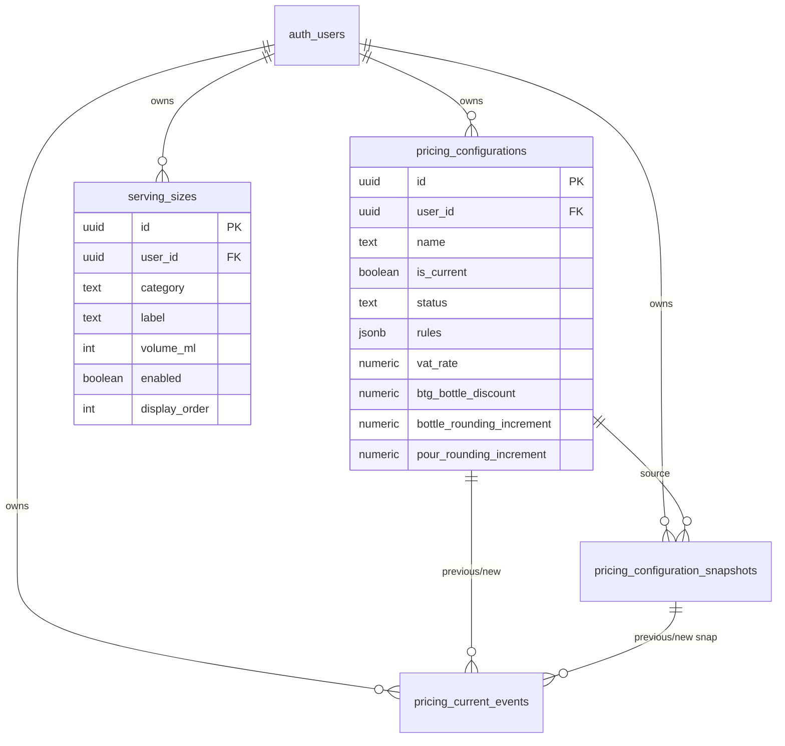

# Data Model — Wine GP Calculator

Documents persistent storage (Supabase) and important in-memory / TypeScript domain structures.

**Schema sources:**

| Authority | Role |
|-----------|------|
| `supabase/migrations/` | Source-controlled history of intended/applied **application** schema evolution |
| Live Supabase project `jcylgbtifwpcjncnnfok` (` wine-gp-calculator`) | Actual deployed database state |
| This file / [`06-current-implementation.md`](./06-current-implementation.md) | Human-readable documentation |

If migrations and live state disagree, **investigate the drift** — do not silently declare either correct without verification.

**Migrations:**

| File | Role |
|------|------|
| `20261019134900_baseline_current_schema.sql` | Baseline of pre-existing `gp_settings` (Stage 3A) |
| `20261019223922_create_pricing_policy.sql` | Additive `pricing_policy` (Stage 3B) |
| `20261022104800_create_serving_sizes.sql` | Additive `serving_sizes` (Stage 3C) |
| `20261026194756_harden_database_access.sql` | FK + grant tightening (Stage 4B2) |
| `20261027092540_create_pricing_configurations.sql` | Pricing Configurations, snapshots, current-events, RPCs, backfill (Stage 5) |
| `20261027093617_revoke_anon_snapshot_hash_execute.sql` | Revoke anon EXECUTE on snapshot hash helper |

**Documentation authority:** Repository/database evidence determines current schema. Canonical intended architecture: [`05-project-architecture.md`](./05-project-architecture.md). Canonical current overview: [`06-current-implementation.md`](./06-current-implementation.md).

Runtime application tables: `public.pricing_configurations`, `public.pricing_configuration_snapshots`, `public.pricing_current_events`, `public.serving_sizes` (plus `auth.users`). Legacy `gp_settings` / `pricing_policy` remain as migration reference only. Sales/scenario entities from `05` are **not** implemented.

---

## Entity Relationship Overview

Serving Sizes are **not** part of a Pricing Configuration and are **not** snapshotted.

---

## Table grants (Stage 5)

| Table | anon | authenticated |
|-------|------|---------------|
| `pricing_configurations` | none | SELECT; column INSERT (name/rules/policy); column UPDATE (name/status/rules/policy/updated_at) — **not** `user_id` / `is_current`; no DELETE |
| `pricing_configuration_snapshots` | none | SELECT only |
| `pricing_current_events` | none | SELECT only |
| `serving_sizes` | none | SELECT, INSERT, UPDATE, DELETE |
| Legacy `gp_settings` / `pricing_policy` | none | SELECT, INSERT, UPDATE (unused by app) |

Controlled RPCs (EXECUTE for `authenticated` only; not anon):

- `ensure_current_pricing_configuration()`
- `capture_pricing_configuration_snapshot(uuid)`
- `make_pricing_configuration_current(uuid)`
- `pricing_configuration_snapshot_content_hash(...)` (dedup helper)

---

## `public.pricing_configurations`

Editable working Pricing Configuration: **GP Rules + Pricing Policy**.

| Constraint / index | Meaning |
|--------------------|---------|
| FK `user_id` → `auth.users` ON DELETE CASCADE | User-owned |
| Partial UNIQUE `(user_id) WHERE is_current` | At most one Current |
| UNIQUE `(user_id, lower(trim(name)))` | Case/whitespace-insensitive names across active+archived |
| CHECK status ∈ {active, archived} | |
| CHECK `NOT is_current OR status = 'active'` | Current must be active |
| Policy CHECKs | Same invariants as legacy pricing_policy |

Defaults: `user_id = auth.uid()`, `is_current = false`, `status = 'active'`, blank policy defaults (20% / 5% / £1 / £0.50), `rules = []`.

**Migration:** existing users’ `gp_settings` + `pricing_policy` copied exactly into **Main Pricing** (`is_current = true`). No initial snapshot or promotion event.

**First-use:** `ensure_current_pricing_configuration` creates Main Pricing Current with empty rules + default policy; app seeds Serving Sizes only when `created = true`.

---

## `public.pricing_configuration_snapshots`

Immutable captured configuration state for reproducibility (Make Current today; Pricing Review / Scenario later).

Contains: source configuration id + **captured name** + rules + policy fields + `content_hash` + timestamps. No Serving Sizes.

Dedup: UNIQUE `(source_configuration_id, content_hash)`. Hash is a deterministic fingerprint (SHA-256 of canonical jsonb), not authentication.

Source FK uses `ON DELETE RESTRICT` so physical deletion of a configuration cannot silently destroy historical snapshots. Configurations are archived, not normally deleted.

---

## `public.pricing_current_events`

Immutable Make Current history:

`previous_configuration_id`, `previous_snapshot_id`, `new_configuration_id`, `new_snapshot_id`, `changed_at`.

Records the factual event “this configuration became Current at this time”. **Not** a general effective-dating system.

---

## `public.serving_sizes`

Unchanged from Stage 3C/4. Runtime pour/carafe catalogue per fixed category. Seeded on genuine first Pricing Configuration provisioning only — intentionally empty lists are never reseeded.

---

## Legacy tables (reference only)

| Table | Status after Stage 5 |
|-------|----------------------|
| `public.gp_settings` | Intact; **no active app reads/writes** |
| `public.pricing_policy` | Intact; **no active app reads/writes** |

Safe to drop only after an explicit cleanup review (see Stage 5 implementation report).

---

## JSONB: `rules`

Same canonical Rule model (`src/types/rules.ts`): `all_gp`, `less_than`, `between`, `greater_than`. Authoritative calculation validity: `validateRuleSetForPricing`. Blank `[]` is allowed for blank alternatives / new-user Main Pricing, but cannot be made Current or captured until non-empty and valid.

---

## TypeScript domain types

| Type | Location |
|------|----------|
| `Rule` variants | `src/types/rules.ts` |
| `PricingPolicy` | `src/lib/pricing/types.ts` |
| `PricingConfiguration` | `src/types/pricingConfigurations.ts` |
| `ServingSize` | `src/types/servingSizes.ts` |
