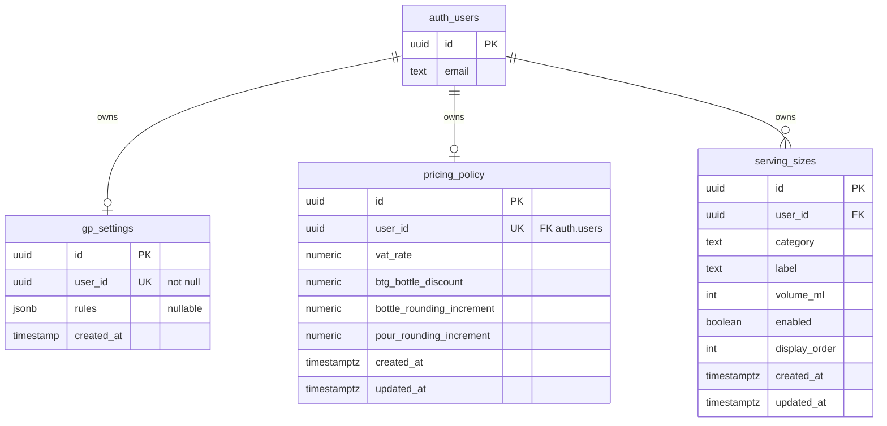

# Data Model — Wine GP Calculator

Documents persistent storage (Supabase) and important in-memory / TypeScript domain structures.

**Schema sources:**

| Authority | Role |
|-----------|------|
| `supabase/migrations/` | Source-controlled history of intended/applied **application** schema evolution |
| Live Supabase project `jcylgbtifwpcjncnnfok` (` wine-gp-calculator`) | Actual deployed database state |
| This file / [`06-current-implementation.md`](./06-current-implementation.md) | Human-readable documentation |

If migrations and live state disagree, **investigate the drift** — do not silently declare either correct without verification.

**Migrations:**

| File | Role |
|------|------|
| `20261019134900_baseline_current_schema.sql` | Baseline of pre-existing `gp_settings` (Stage 3A; did not alter live schema) |
| `20261019223922_create_pricing_policy.sql` | Additive `pricing_policy` table + RLS + seed (Stage 3B) |
| `20261022104800_create_serving_sizes.sql` | Additive `serving_sizes` table + RLS + seed (Stage 3C) |

**Documentation authority:** Repository/database evidence determines current schema. Canonical intended architecture: [`05-project-architecture.md`](./05-project-architecture.md). Canonical current overview: [`06-current-implementation.md`](./06-current-implementation.md). This file provides supporting schema/type detail. If sources materially disagree, investigate rather than silently reconciling them.

Application tables today: `public.gp_settings`, `public.pricing_policy`, `public.serving_sizes` (plus Supabase-managed `auth.users`). Sales, scenario, and versioning entities from `05` are **not** implemented. Wine categories are fixed (not user-configurable).

---

## Entity Relationship Overview



Logical relationship: `gp_settings.user_id` corresponds to `auth.users.id`.  
**Fact:** **No foreign-key constraint** from `gp_settings.user_id` to `auth.users` (legacy; unchanged in Stage 3B). Enforcement is application + RLS.

`pricing_policy.user_id` **does** have `REFERENCES auth.users(id) ON DELETE CASCADE` plus `UNIQUE(user_id)`.

---

## Persistent Tables

### `public.gp_settings`

| | |
|--|--|
| **Purpose** | Store each user’s GP pricing rule set |
| **Table comment (DB)** | “User defines their GP Settings” |
| **RLS** | Enabled |
| **Source in app** | Read from `src/app/page.tsx` and `src/app/gp-setup/page.tsx`; written from `src/app/gp-setup/page.tsx` |

#### Columns

| Column | Type | Nullable | Default | Notes |
|--------|------|----------|---------|-------|
| `id` | `uuid` | NO | `gen_random_uuid()` | Primary key |
| `user_id` | `uuid` | NO | — | **UNIQUE** (one row per user) |
| `rules` | `jsonb` | YES | — | Array of rule objects (see below) |
| `created_at` | `timestamp` (without time zone) | NO | `now()` | Set on insert; app does not update this field in code |

#### Constraints & indexes

| Name | Definition |
|------|------------|
| `gp_settings_pkey` | PRIMARY KEY (`id`) — unique btree index |
| `gp_settings_user_id_key` | UNIQUE (`user_id`) — unique btree index |

#### RLS policy

| Policy name | Command | USING / WITH CHECK |
|-------------|---------|---------------------|
| `Policy with security definer functions` | ALL | `auth.uid() = user_id` |

Authenticated users can only CRUD their own row. Anon users cannot access rows under this policy.

#### Write patterns in code

| Path | Method |
|------|--------|
| First-time save (`gp-setup`) | `select` by `user_id` → if missing, `insert([{ user_id, rules }])` else `update({ rules })` |
| Custom wizard | `upsert({ user_id, rules }, { onConflict: 'user_id' })` |

---

### `public.pricing_policy`

| | |
|--|--|
| **Purpose** | Store each user’s current commercial pricing policy (VAT, BTG bottle discount, rounding) |
| **Table comment (DB)** | “Current commercial pricing policy per user (VAT, BTG bottle discount, rounding).” |
| **RLS** | Enabled |
| **Source in app** | `src/lib/pricingPolicyStore.ts`; Settings `/settings`; Calculator loads via `getOrCreatePricingPolicy` |

#### Columns

| Column | Type | Nullable | Default | Semantics |
|--------|------|----------|---------|-----------|
| `id` | `uuid` | NO | `gen_random_uuid()` | Primary key |
| `user_id` | `uuid` | NO | — | **UNIQUE**; FK → `auth.users(id)` ON DELETE CASCADE |
| `vat_rate` | `numeric` | NO | `0.20` | Decimal fraction (`0.20` = 20% VAT) |
| `btg_bottle_discount` | `numeric` | NO | `0.05` | Decimal fraction (`0.05` = 5%); bottle line only when BTG |
| `bottle_rounding_increment` | `numeric` | NO | `1.00` | £ increment for bottle prices |
| `pour_rounding_increment` | `numeric` | NO | `0.50` | £ increment for pour/glass prices |
| `created_at` | `timestamptz` | NO | `now()` | |
| `updated_at` | `timestamptz` | NO | `now()` | Set explicitly by app on save |

#### Constraints

| Name | Definition |
|------|------------|
| `pricing_policy_pkey` | PRIMARY KEY (`id`) |
| `pricing_policy_user_id_key` | UNIQUE (`user_id`) |
| `pricing_policy_user_id_fkey` | FK → `auth.users(id)` ON DELETE CASCADE |
| `pricing_policy_vat_rate_check` | `vat_rate >= 0` |
| `pricing_policy_btg_bottle_discount_check` | `btg_bottle_discount >= 0 AND btg_bottle_discount < 1` |
| `pricing_policy_bottle_rounding_increment_check` | `bottle_rounding_increment > 0` |
| `pricing_policy_pour_rounding_increment_check` | `pour_rounding_increment > 0` |

#### RLS policies

| Policy | Command | Role | Rule |
|--------|---------|------|------|
| `pricing_policy_select_own` | SELECT | authenticated | `auth.uid() = user_id` |
| `pricing_policy_insert_own` | INSERT | authenticated | `auth.uid() = user_id` |
| `pricing_policy_update_own` | UPDATE | authenticated | `auth.uid() = user_id` |

No DELETE policy (app does not delete policies). Anon has no permissive policy; RLS prevents anonymous row access.

#### Provisioning

- **Existing users:** seeded in migration `20261019223922` via `INSERT … SELECT id FROM auth.users ON CONFLICT DO NOTHING` (column defaults = Stage 2 commercial defaults).
- **New users:** `getOrCreatePricingPolicy(userId)` selects; if missing, inserts `{ user_id }` only (DB defaults); concurrent unique violation → re-select. Load/provision errors are returned — calculator does **not** silently use in-memory defaults.

UI percentages (`20`) convert to rates (`0.20`) in `src/lib/pricingPolicyStore.ts` (`percentToRate` / `rateToPercent`).

---

### `public.serving_sizes`

| | |
|--|--|
| **Purpose** | User-configured pour/carafe serving sizes within fixed wine categories |
| **RLS** | Enabled |
| **Source in app** | `src/lib/servingSizeStore.ts`; Settings `/settings`; Calculator loads via `listServingSizes` |

Bottle is **not** stored as a serving-size row. The calculator’s full-bottle line remains independent.

#### Columns

| Column | Type | Nullable | Default | Notes |
|--------|------|----------|---------|-------|
| `id` | `uuid` | NO | `gen_random_uuid()` | PK |
| `user_id` | `uuid` | NO | — | FK → `auth.users(id)` ON DELETE CASCADE |
| `category` | `text` | NO | — | `dry` \| `sparkling` \| `sweet_fortified` only |
| `label` | `text` | NO | — | Non-blank after trim |
| `volume_ml` | `integer` | NO | — | Must be `> 0` |
| `enabled` | `boolean` | NO | `true` | Disabled rows hidden on calculator |
| `display_order` | `integer` | NO | — | Must be `>= 0`; spaced 10/20/30… by default |
| `created_at` / `updated_at` | `timestamptz` | NO | `now()` | |

#### Constraints / indexes

| Name | Definition |
|------|------------|
| `serving_sizes_pkey` | PRIMARY KEY (`id`) |
| `serving_sizes_user_id_fkey` | FK → `auth.users` ON DELETE CASCADE |
| Category / label / volume / order checks | As above |
| `serving_sizes_user_category_label_key` | UNIQUE (`user_id`, `category`, `lower(trim(label))`) |
| `serving_sizes_user_category_order_idx` | Index on (`user_id`, `category`, `display_order`) |

#### RLS

| Policy | Command |
|--------|---------|
| `serving_sizes_select_own` | SELECT own |
| `serving_sizes_insert_own` | INSERT own |
| `serving_sizes_update_own` | UPDATE own |
| `serving_sizes_delete_own` | DELETE own |

#### Defaults (seed + first-use)

| Category | Order | Label | ml |
|----------|-------|-------|-----|
| dry | 10–40 | Small / Medium / Large glass, Carafe | 125 / 175 / 250 / 500 |
| sparkling | 10–20 | Coravin glass, Standard glass | 125 / 150 |
| sweet_fortified | 10 | Small glass | 75 |

Existing users seeded in migration. Future users seeded only when Pricing Policy is first created (`getOrCreatePricingPolicy` → `seedDefaultServingSizes`). An intentionally empty serving-size list is **not** reseeded on later loads.

Canonical TS type: `src/types/servingSizes.ts`. Defaults: `src/lib/servingSizeDefaults.ts`.

---

### `auth.users` (Supabase-managed)

Used indirectly via Auth APIs (`signUp`, `signInWithPassword`, `getSession`).  
The app reads `session.user.id` (and signup/login email). It does **not** define this table.

**Important mismatch:** `src/app/login/page.tsx` queries `supabase.from('users')`, which targets **`public.users`**. That table **does not exist** in the live database (only `auth.users`). Documented as a known defect in `AI_CONTEXT.md`.

---

## JSONB: `gp_settings.rules`

Stored as a JSON array. TypeScript source of truth: `src/types/rules.ts`.

### Discriminated union

```ts
type Rule = LessThanRule | GreaterThanRule | BetweenRule | AllGpRule
```

| `type` | Fields | Meaning |
|--------|--------|---------|
| `all_gp` | `gp: number` | Single GP for all costs |
| `less_than` | `max: number`, `gp: number` | If cost **&lt;** max → GP |
| `greater_than` | `min: number`, `gp: number` | If cost **&gt;** min → GP |
| `between` | `min`, `max`, `start_gp`, `end_gp` | Inclusive cost band; GP linearly interpolates from `start_gp` → `end_gp` |

There is **no DB-level JSON schema validation** observed; invalid shapes would be a client-side concern.

### Example documents

**Universal:**

```json
[{ "type": "all_gp", "gp": 70 }]
```

**Custom bands (illustrative):**

```json
[
  { "type": "less_than", "max": 10, "gp": 75 },
  { "type": "between", "min": 10, "max": 25, "start_gp": 75, "end_gp": 65 },
  { "type": "greater_than", "min": 25, "gp": 65 }
]
```

### Intended contiguity

Setup UX expects custom rules to form a continuous cost axis: `less_than.max` equals the next rule’s `min`, and so on through `greater_than.min`. Overlaps and gaps are checked in `src/app/gp-setup/page.tsx`.

---

## Important Transient / UI State (not persisted)

### Calculator (`src/app/page.tsx`)

| State | Type | Role |
|-------|------|------|
| `costPriceInput` | `string` | Raw cost field |
| `wineType` | `"Dry" \| "Sweet" \| "Sparkling"` | Maps to fixed serving-size category |
| `isBTG` | `boolean` | By-the-glass mode |
| `gp` / `suggestedGp` | `number` | Active / rule-suggested GP % |
| `rules` | `Rule[]` | Loaded from DB |
| `pricingPolicy` | `PricingPolicy` | Loaded/ensured from `pricing_policy` |
| `servingSizes` | `ServingSize[]` | Loaded from `serving_sizes` (may be empty) |
| `bottleSize` | string enum-like | Half / Bottle / Magnum / Other |
| `customBottleSizeInput` | `string` | Custom ml when Other |
| `showSetupModal` | `boolean` | Force rule creation |

Operational pour catalogues come from persisted `serving_sizes`, not hardcoded arrays.

### GP setup (`src/app/gp-setup/page.tsx`)

| State | Role |
|-------|------|
| `rules` | Working copy of rule array |
| `editingIndex` / `tempRule` | Inline edit buffer |
| `gaps` / `gapModalOpen` | Missing-band UX |
| `formHasError` | Disables Save while form invalid |

### Auth forms

Email/password strings and local validation error strings only; accounts live in Supabase Auth.

---

## TypeScript Domain Types

**Canonical file:** `src/types/rules.ts`

```ts
export interface BaseRule {
  type: 'less_than' | 'between' | 'greater_than' | 'all_gp'
}
// LessThanRule, GreaterThanRule, BetweenRule, AllGpRule, Rule
```

Active calculator and Pricing Rules code imports these types. There is no second rule-model definition in the application.

---

## Relationships Summary

| From | To | Cardinality | Mechanism |
|------|----|-------------|-----------|
| Auth user | `gp_settings` | 0..1 | `user_id` unique + app logic (no FK) |
| Auth user | `pricing_policy` | 0..1 | `user_id` unique + FK CASCADE + app provisioning |
| Auth user | `serving_sizes` | 0..n | FK CASCADE; unique label per user+category |
| `gp_settings.rules` | Rule objects | 0..n in JSON array | Application convention |

Wine categories are fixed identifiers only. No sales/scenario entities yet.
