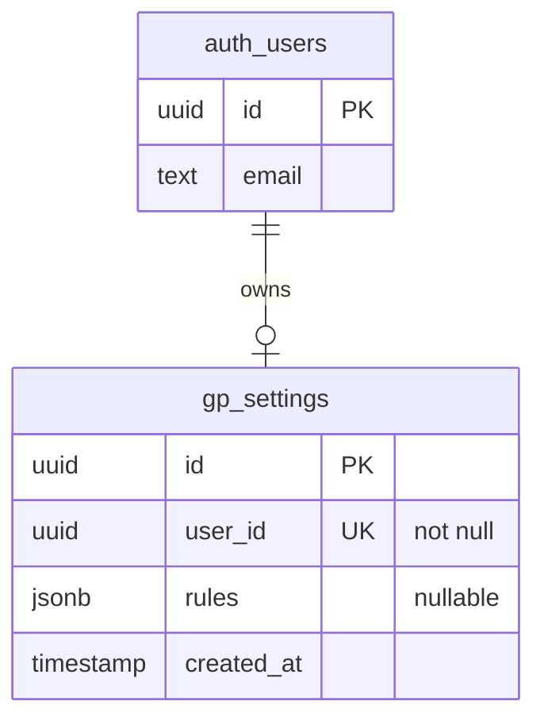

# Data Model — Wine GP Calculator

Documents persistent storage (Supabase) and important in-memory / TypeScript domain structures.

**Schema sources (Stage 3A):**

| Authority | Role |
|-----------|------|
| `supabase/migrations/` | Source-controlled history of intended/applied **application** schema evolution |
| Live Supabase project `jcylgbtifwpcjncnnfok` (` wine-gp-calculator`) | Actual deployed database state |
| This file / [`06-current-implementation.md`](./06-current-implementation.md) | Human-readable documentation |

If migrations and live state disagree, **investigate the drift** — do not silently declare either correct without verification.

**Baseline:** `supabase/migrations/20261019134900_baseline_current_schema.sql` represents the existing application schema (`public.gp_settings` + RLS/grants). Stage 3A did **not** alter that live schema.

**Documentation authority:** Repository/database evidence determines current schema. Canonical intended architecture: [`05-project-architecture.md`](./05-project-architecture.md). Canonical current overview: [`06-current-implementation.md`](./06-current-implementation.md). This file provides supporting schema/type detail. If sources materially disagree, investigate rather than silently reconciling them.

Only `auth.users` and `public.gp_settings` exist today. Sales, scenario, and versioning entities described as intended architecture in `05` are **not** implemented.

---

## Entity Relationship Overview



Logical relationship: `gp_settings.user_id` corresponds to `auth.users.id`.  
**Fact:** At inspection time, **no foreign-key constraint** existed from `gp_settings.user_id` to `auth.users`. Enforcement is application + RLS.

---

## Persistent Tables

### `public.gp_settings`

| | |
|--|--|
| **Purpose** | Store each user’s GP pricing rule set |
| **Table comment (DB)** | “User defines their GP Settings” |
| **RLS** | Enabled |
| **Source in app** | Queried/written from `src/app/page.tsx`, `src/app/gp-setup/page.tsx`, `src/app/gp-setup/custom/page.tsx` |

#### Columns

| Column | Type | Nullable | Default | Notes |
|--------|------|----------|---------|-------|
| `id` | `uuid` | NO | `gen_random_uuid()` | Primary key |
| `user_id` | `uuid` | NO | — | **UNIQUE** (one row per user) |
| `rules` | `jsonb` | YES | — | Array of rule objects (see below) |
| `created_at` | `timestamp` (without time zone) | NO | `now()` | Set on insert; app does not update this field in code |

#### Constraints & indexes

| Name | Definition |
|------|------------|
| `gp_settings_pkey` | PRIMARY KEY (`id`) — unique btree index |
| `gp_settings_user_id_key` | UNIQUE (`user_id`) — unique btree index |

#### RLS policy

| Policy name | Command | USING / WITH CHECK |
|-------------|---------|---------------------|
| `Policy with security definer functions` | ALL | `auth.uid() = user_id` |

Authenticated users can only CRUD their own row. Anon users cannot access rows under this policy.

#### Write patterns in code

| Path | Method |
|------|--------|
| First-time save (`gp-setup`) | `select` by `user_id` → if missing, `insert([{ user_id, rules }])` else `update({ rules })` |
| Custom wizard | `upsert({ user_id, rules }, { onConflict: 'user_id' })` |

---

### `auth.users` (Supabase-managed)

Used indirectly via Auth APIs (`signUp`, `signInWithPassword`, `getSession`).  
The app reads `session.user.id` (and signup/login email). It does **not** define this table.

**Important mismatch:** `src/app/login/page.tsx` queries `supabase.from('users')`, which targets **`public.users`**. That table **does not exist** in the live database (only `auth.users`). Documented as a known defect in `AI_CONTEXT.md`.

---

## JSONB: `gp_settings.rules`

Stored as a JSON array. TypeScript source of truth: `src/types/rules.ts`.

### Discriminated union

```ts
type Rule = LessThanRule | GreaterThanRule | BetweenRule | AllGpRule
```

| `type` | Fields | Meaning |
|--------|--------|---------|
| `all_gp` | `gp: number` | Single GP for all costs |
| `less_than` | `max: number`, `gp: number` | If cost **&lt;** max → GP |
| `greater_than` | `min: number`, `gp: number` | If cost **&gt;** min → GP |
| `between` | `min`, `max`, `start_gp`, `end_gp` | Inclusive cost band; GP linearly interpolates from `start_gp` → `end_gp` |

There is **no DB-level JSON schema validation** observed; invalid shapes would be a client-side concern.

### Example documents

**Universal:**

```json
[{ "type": "all_gp", "gp": 70 }]
```

**Custom bands (illustrative):**

```json
[
  { "type": "less_than", "max": 10, "gp": 75 },
  { "type": "between", "min": 10, "max": 25, "start_gp": 75, "end_gp": 65 },
  { "type": "greater_than", "min": 25, "gp": 65 }
]
```

### Intended contiguity

Setup UX expects custom rules to form a continuous cost axis: `less_than.max` equals the next rule’s `min`, and so on through `greater_than.min`. Overlaps and gaps are checked in `src/app/gp-setup/page.tsx`.

---

## Important Transient / UI State (not persisted)

### Calculator (`src/app/page.tsx`)

| State | Type | Role |
|-------|------|------|
| `costPriceInput` | `string` | Raw cost field |
| `wineType` | `"Dry" \| "Sweet" \| "Sparkling"` | Pour size catalogue key |
| `isBTG` | `boolean` | By-the-glass mode |
| `gp` / `suggestedGp` | `number` | Active / rule-suggested GP % |
| `rules` | `Rule[]` | Loaded from DB |
| `bottleSize` | string enum-like | Half / Bottle / Magnum / Other |
| `customBottleSizeInput` | `string` | Custom ml when Other |
| `showSetupModal` | `boolean` | Force rule creation |

Constants (not state): `VAT_RATE = 0.2`, `WINE_SIZES` map.

### GP setup (`src/app/gp-setup/page.tsx`)

| State | Role |
|-------|------|
| `rules` | Working copy of rule array |
| `editingIndex` / `tempRule` | Inline edit buffer |
| `gaps` / `gapModalOpen` | Missing-band UX |
| `formHasError` | Disables Save while form invalid |

### Auth forms

Email/password strings and local validation error strings only; accounts live in Supabase Auth.

---

## TypeScript Domain Types

**Canonical file:** `src/types/rules.ts`

```ts
export interface BaseRule {
  type: 'less_than' | 'between' | 'greater_than' | 'all_gp'
}
// LessThanRule, GreaterThanRule, BetweenRule, AllGpRule, Rule
```

**Duplicated (drift risk):**

- Inline copies in `src/app/page.tsx`
- Inline copies in `src/app/gp-setup/custom/page.tsx` (subset: no `AllGpRule`)

Prefer importing from `@/types/rules` for new work.

---

## Relationships Summary

| From | To | Cardinality | Mechanism |
|------|----|-------------|-----------|
| Auth user | `gp_settings` | 0..1 | `user_id` unique + app logic |
| `gp_settings.rules` | Rule objects | 0..n in JSON array | Application convention |

No other application entities (wines, venues, price history, audit of calculations) exist in this codebase or public schema.
